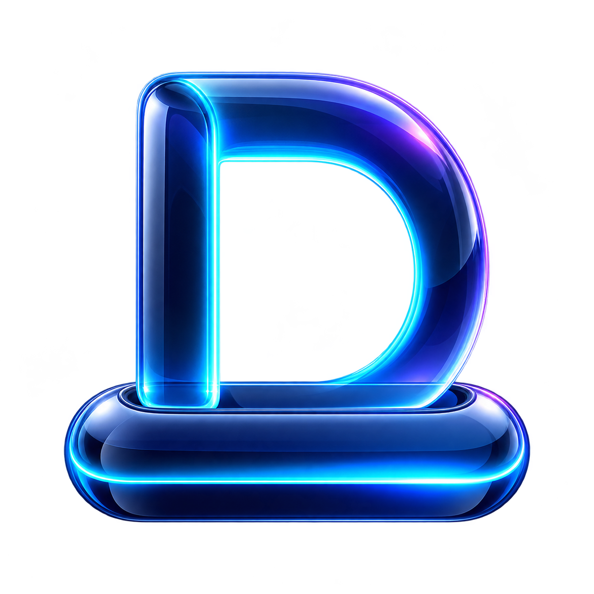
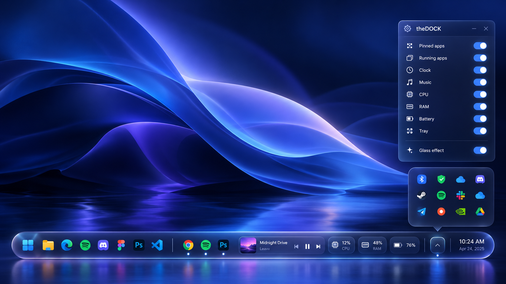

# theDOCK

theDOCK adalah proyek pengganti taskbar Windows 11 yang ringan, dengan tampilan *liquid glass*. Kode saat ini adalah **prototipe awal**, belum pengganti taskbar yang siap dipakai sehari-hari.

## Arah produk

- Saat theDOCK aktif, taskbar Windows disembunyikan. Saat theDOCK ditutup atau gagal berjalan, taskbar harus dipulihkan ke keadaan sebelumnya.
- Dock memuat peluncur aplikasi, aplikasi yang sedang berjalan, widget pilihan, jam, dan tombol Tray. Setiap komponen tampilan dapat diaktifkan atau dinonaktifkan sendiri.
- Tombol Tray membuka panel ikon yang menyatu dengan dock. Ikon tersembunyi sebelum tombol diklik; rancangan ini tidak membuka panel tray bawaan Windows.
- Pengaturan harus tetap dapat dibuka lewat menu dock atau pintasan keyboard, termasuk saat seluruh komponen tampilan dimatikan.
- Efek kaca dapat dimatikan atau dikurangi untuk menghemat sumber daya.

Lihat [spesifikasi konsep](docs/konsep.md) untuk tujuan produk dan [catatan pengembangan](docs/pengembangan.md) untuk status fitur serta cara membangun prototipe. Mockup adalah ilustrasi rancangan, bukan tangkapan layar aplikasi yang sudah berjalan.

## Status

Prototipe Win32 sudah memiliki dock, tombol Start, aplikasi yang dipin dan sedang berjalan, jam, tanggal, kalender sederhana, kontrol putar/jeda media, informasi CPU/RAM/baterai, serta sakelar tiap komponen. Aplikasi dapat dipin dengan menyeret berkas atau pintasan ke dock; klik kanan ikon pin untuk mengubah urutan atau melepasnya. Posisi atas/bawah, lebar dock, sembunyi otomatis, dan kaca terang/gelap dapat dipilih. Taskbar dipulihkan oleh pengawas terpisah ketika aplikasi utama berhenti.

Panel Tray menyediakan kontrol volume dan jalan pintas ke pengaturan jaringan/Bluetooth, tetapi **belum menampilkan atau mengendalikan ikon tray aplikasi lain**. [Catatan validasi tray](docs/tray-feasibility.md) menjelaskan batas API dan alat diagnostik yang tersedia. Ikon theDOCK sudah ditanam ke executable Windows. Tampilan kaca memakai dasar transparan dan mencoba efek DWM Windows 11; hasil visualnya masih perlu diuji ulang di Windows.

Kode lolos pemeriksaan kompilasi target Windows dan unit test di lingkungan Linux. Pengujian interaktif di Windows 11 masih diperlukan sebelum perilaku taskbar dan tampilannya dapat dinyatakan bekerja.
